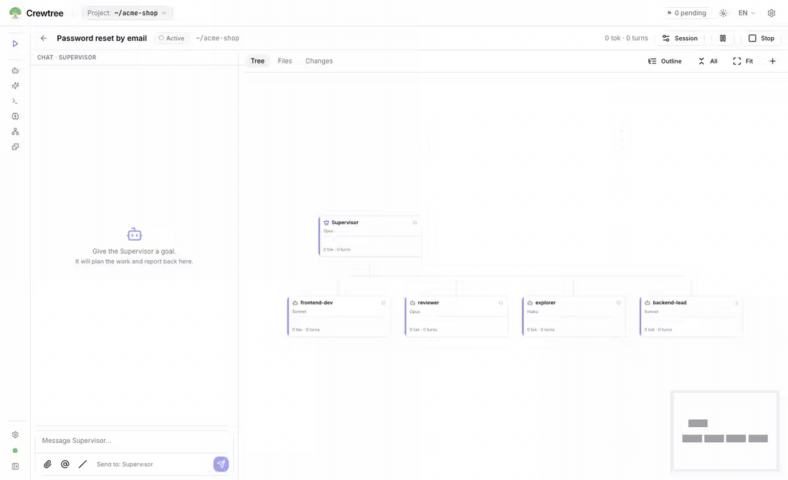
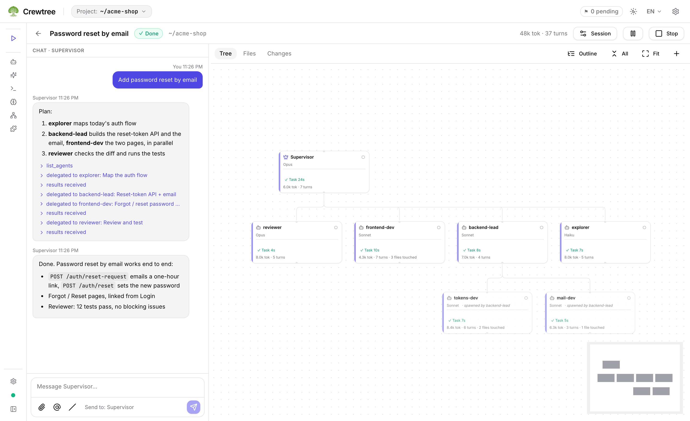
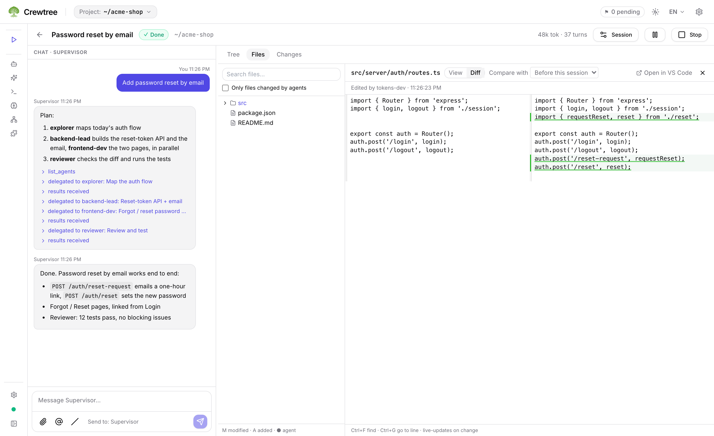

<p align="center">
  
</p>

<h1 align="center">Crewtree</h1>

> Give one goal to a Supervisor and watch it split the work across a tree of Claude Code agents, each with its
> own role, model and tools, while you approve, steer and chat with any of them from a local web UI.

<p align="center">
  <a href="https://github.com/NamHuynh98/Crewtree/releases/latest"></a>
  <a href="LICENSE"></a>
  
  
  <a href="https://github.com/NamHuynh98/Crewtree/actions/workflows/ci.yml"></a>
</p>

<p align="center">
  
</p>

<p align="center"><sub>One message, seven agents, three levels: the Supervisor plans and delegates, <code>backend-lead</code> spawns two implementers, an edit waits for your approval, and every changed file is listed at the end.</sub></p>

---

## Why Crewtree

Claude Code is great at one task in one terminal. Real work is rarely one task: a feature needs someone to read
the codebase, someone to plan, a couple of people to write code and someone to check it. Today you either keep
everything in one long conversation (the context fills up and the agent loses the thread), or you open several
terminals and become the project manager yourself: copying results between windows, remembering who touches
which file, approving permission prompts in five places at once.

Claude Code's own subagents help, but they run hidden inside one turn: you cannot see them working, talk to one
of them, or stop one without stopping everything.

Crewtree turns that into a team you can see. You describe the goal once; a **Supervisor** breaks it down and
delegates tasks to agents from your own library, and those agents can delegate further, as deep as you allow.
Every node is a real Claude Code session that you can open, read, chat with, pause or redirect. Permission
prompts from every level land in one inbox. Two agents never edit the same file without Crewtree noticing. And
it all runs on your machine, on your existing Claude Code login: no API key, no cloud service, nothing to deploy.

## How it works

```
  you ──► Supervisor ──delegate_task──► lead-coder ──delegate_task──► implementer ×2
              │                             │                              │
              │◄──────── results ◄──────────┴────────── ask_parent ◄───────┘
              │
         researcher, analyst …      (any agent with canDelegate, only the agents it may use)

  web UI (127.0.0.1) ◄── events ── Crewtree server ── Claude Agent SDK / Claude Code CLI ── your Claude login
```

The Crewtree server starts each agent as its own Claude Code session and gives it a few orchestration tools
(`delegate_task`, `wait_for_tasks`, `ask_parent`, `complete_task` and a few more). Tasks, messages, approvals and file leases
are stored in a local SQLite database, so a session survives a server restart and picks up where it stopped.
The web UI draws the tree live, streams each agent's output, and sends your answers back into the right session.

## What you get

- **A live tree of agents.** The canvas shows who is working on what, who is waiting for whom, tokens and turns
  per node. Click a node to read its activity, the tasks it received and the files it changed.
- **Talk to any node, not only the top.** Each agent has its own chat. Send it a hint, interrupt it, or queue a
  message for when it finishes its turn; its parent is told about your intervention.
- **One inbox for permissions.** Tool approvals from every depth arrive in one place, with the agent and the
  command or file in question. Allow once, or always allow that kind of call for that agent in the session.
- **Agents that know their limits.** An agent only delegates to the agents listed in its `delegates`, only uses
  its `tools`, and only edits inside the scope its task was given. Depth, number of agents, turns and a token
  budget are capped per session; the session pauses itself when the budget is used.
- **No silent collisions.** Agents share one working folder. Edits take a file lease; a second agent trying to
  edit a leased file is blocked and you see it. Changes made through shell commands are detected and reported.
- **Your existing library.** Agents, skills, commands, memory (`CLAUDE.md`), MCP servers and plugins from
  `~/.claude` and the project's `.claude/` show up automatically. Create or edit them in the UI; the files stay
  plain Claude Code files, so the `claude` CLI uses them too.
- **Pick the model per node.** Models come from what your account can use, the same list `/model` shows; set
  one per agent, per session or in bulk, with a fallback model when the first is unavailable. The default
  Supervisor follows the model your account recommends and moves to newer releases by itself.
- **Cheap when idle, resumable after a crash.** Idle agents are suspended and resume with their context on the
  next message. Kill the server mid-turn, start it again, and the session continues.
- **Your plan usage at a glance.** The sidebar shows the same windows as `/usage` in Claude Code (5-hour
  session, weekly, per model) with the reset time, so you see a busy tree eating into your plan before it stops.
- **A local app that behaves like one.** `crewtree` opens its own window (no tabs, no address bar) when Chrome,
  Edge, Brave or Chromium is installed, and the UI installs as an app for a Dock / Start menu icon. One-line
  install, `crewtree update` with automatic database backup and `crewtree rollback`, optional start at login,
  English and Vietnamese UI, light and dark theme.

<table>
  <tr>
    <td width="50%"></td>
    <td width="50%"></td>
  </tr>
  <tr>
    <td align="center"><sub>The tree: who did what, how long it took, what it cost</sub></td>
    <td align="center"><sub>Every edit, by agent, as a diff against the start of the session</sub></td>
  </tr>
</table>

## Supported platforms

| Platform | Status |
|---|---|
| macOS (Apple Silicon, Intel) | Supported; the primary platform |
| Windows x64 | Supported (native, PowerShell installer; Git for Windows required by Claude Code) |
| Linux x64 / arm64 (glibc or musl), WSL | Supported |
| Node.js | 22 or newer; the release adapts to the Node you run and to later upgrades |
| Agent runtime | Claude Code (Agent SDK, with the `claude` CLI as fallback). Other CLIs are planned |

Every release is built and smoke-tested on all five targets: install, start, update → rollback with a database
migration, autostart on/off, and a run on a different Node major than the one it was packed with.

## Compared with what you may use today

| Instead of | What stays the same | What you gain |
|---|---|---|
| One long Claude Code conversation | Same Claude Code, same login, same tools | Each agent keeps a small, focused context; work runs in parallel |
| Claude Code subagents (Task tool) | Agents are defined the same way, in `.md` files | You see every agent, talk to it, approve its tools, and agents can delegate several levels deep |
| Several terminals with `claude` | Real Claude Code sessions in your project | One window, results passed back automatically, one approval inbox, file conflicts detected |

Crewtree does not replace Claude Code; it coordinates it. Everything an agent does is a Claude Code action
under your settings, permissions and hooks.

## Quick start

You need **Node 22+** and **Claude Code**, installed and logged in (run `claude` once).

### macOS and Linux

```bash
curl -fsSL https://github.com/NamHuynh98/Crewtree/releases/latest/download/install.sh | sh
cd ~/my-project && crewtree        # starts the server and opens the UI for this folder
```

### Windows (PowerShell)

```powershell
irm https://github.com/NamHuynh98/Crewtree/releases/latest/download/install.ps1 | iex
cd ~\my-project; crewtree
```

The installers need no admin rights, show each step, and verify the download against `SHA256SUMS` before
extracting anything. The Claude Agent SDK is installed from npm on your machine: it is Anthropic's proprietary
software and is not redistributed with Crewtree (see `NOTICE`).

Options: `CREWTREE_VERSION=v0.1.0` for a specific release, `CREWTREE_INSTALL_DIR=…` for another location,
`CREWTREE_MODIFY_PATH=1` to add `~/.local/bin` to your shell profile.

> Official releases are only published at https://github.com/NamHuynh98/Crewtree/releases. Check where a file
> comes from with `gh attestation verify <file> --owner NamHuynh98` (see `SECURITY.md`).

If in doubt, run `crewtree doctor`: it checks Node, Claude Code, folder permissions, the server and, on Windows,
Git Bash.

## Everyday use

In the UI, start a session in your project and write what you want, for example:

- "Add password reset to the login page, with tests."
- "Find why the export job is slow and propose a fix; do not change code yet."
- "Review the open changes in `src/billing` for security problems."

Then watch the tree grow, answer the questions agents send up, and approve what they ask for.

From the terminal:

```
crewtree [path] [--browser]   start the server if needed and open the UI for that project (default: .)
                              in its own window, or a browser tab with --browser
crewtree stop | status        stop the server / pid, port, uptime, running agents, version
crewtree logs [-f]            server log
crewtree doctor               check Node, Claude Code, permissions, server, port, Git Bash (Windows)
crewtree update [version]     update (--check, --pre, --wait, --force, --archive <file> for offline)
crewtree rollback             go back to the previous version and its database backup
crewtree autostart on|off     start at login (launchd, Task Scheduler, systemd or XDG autostart)
crewtree uninstall [--purge]  remove Crewtree; your data in ~/.crewtree stays unless --purge
```

## Security and privacy

- The server listens on `127.0.0.1` only and checks the `Host` and `Origin` of every request, so other sites in
  your browser cannot talk to it. The UI signs in with a one-time link that `crewtree` opens for you; the sign-in lasts 30 days.
- Crewtree has no account, no telemetry and no cloud backend. Your prompts go from Claude Code to Anthropic as
  they would in a terminal; everything else (sessions, tasks, events) stays in `~/.crewtree`.
- Agents run with your Claude Code permission settings and hooks; anything they would ask you about in a
  terminal is asked in the approval inbox instead. `~/.claude` is only changed when you edit a resource in the UI.

Report a vulnerability as described in `SECURITY.md`.

## Being honest about it

- **Many agents means many tokens.** Every node is a full Claude Code session on your plan. Start with the
  default limits (concurrent agents, depth, turns, token budget per session) and raise them when you trust a setup.
- **One working folder.** Agents share the project folder; leases prevent two agents from editing the same file
  through edit tools, but a change made with a shell command is detected after it happens, not before.
- **Claude Code only, for now.** The runtime layer is ready for other CLIs (OpenCode, Codex CLI, Gemini CLI),
  but they are not implemented yet.
- **Young software.** Crewtree is at its first releases (v0.1.x).

## Architecture

```
apps/
  server/   Fastify + SQLite (drizzle): sessions, agent runtime, task manager, file leases, approvals, REST + WebSocket
  web/      React UI: sessions, tree canvas, chats, approval inbox, Claude config manager, settings
  cli/      the `crewtree` command: start/stop, doctor, update/rollback, autostart, uninstall
packages/
  shared/   types and schemas shared by server, web and CLI
scripts/    release packing, installers, smoke tests
docs/       logo and images
```

Each agent runs through an `AgentDriver` (Agent SDK first, `claude` CLI as fallback) that emits normalized
events; the task manager turns orchestration tool calls into tasks, and the event bus stores and broadcasts
everything the UI shows.

## Documentation

| Document | What is in it |
|---|---|
| [`CONTRIBUTING.md`](CONTRIBUTING.md) | How to build, test and send changes (DCO sign-off) |
| [`SECURITY.md`](SECURITY.md) | Reporting vulnerabilities, verifying releases |
| [`TRADEMARKS.md`](TRADEMARKS.md) | Use of the Crewtree name and logo |

## Develop

```bash
git clone https://github.com/NamHuynh98/Crewtree.git && cd Crewtree
pnpm install && pnpm dev        # server on :4317, web on :5173
pnpm test                       # unit and integration tests (FakeDriver, no Claude account needed)
pnpm pack                       # release bundle for this platform in dist-release/
```

## License and acknowledgements

Apache-2.0, see `LICENSE` and `NOTICE`. The name and logo are covered by `TRADEMARKS.md`. Crewtree is an
independent project and is not affiliated with or endorsed by Anthropic.

Built on [Claude Code](https://docs.claude.com/claude-code) and the Claude Agent SDK, Fastify, SQLite
(better-sqlite3, drizzle), React and React Flow. Much of the code was written with Claude Code itself.
